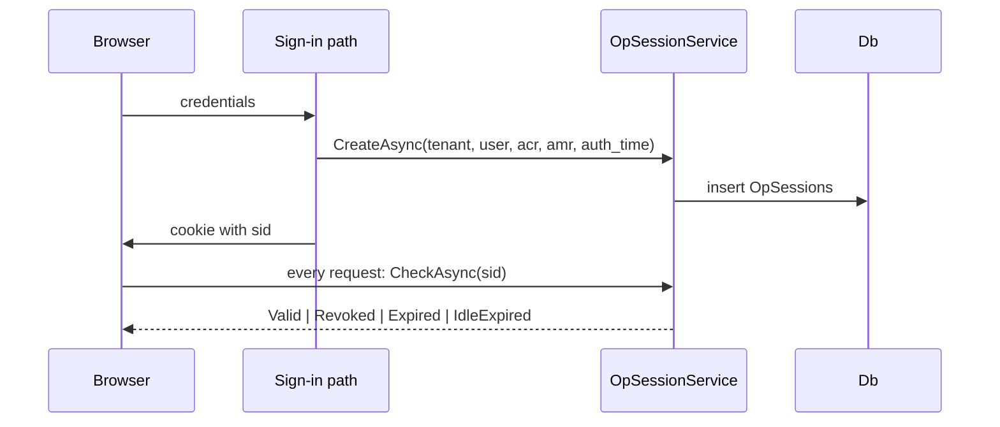

The OP session store is the server-side truth behind the `sid`. Every sign-in creates one; the session decides
whether the cookie is still valid, which applications took part in it, and which refresh tokens belong to it.

## The model

- `OpSessions` holds one row per sign-in: the tenant, the user, when the user authenticated (`AuthTime`), when
  the session was last used (`LastSeenAt`), the absolute deadline (`ExpiresAt`), the idle deadline
  (`IdleExpiresAt`), the authentication context (`Acr`, `AmrJson`, `UpstreamIdp`), the hash of the address
  (`IpHash`) and the user agent. The row id is the `sid`.
- `OpSessionClients` records the applications that received a token in the session. It drives the targeted
  front- and back-channel logout.
- `Tokens.SessionId` binds the refresh tokens to the session, so ending a session ends the tokens it produced.

A session is valid while `RevokedAt IS NULL AND ExpiresAt > now AND IdleExpiresAt > now`.

## The flow

- Every sign-in path (password, TOTP, passkey, external IdP, QR, tenant switch) creates the session itself
  through `OpSessionSignIn`, so the paths cannot drift apart. The tenant switch creates a session in the new
  tenant and leaves the old one in the old tenant.
- A cookie that was issued before the store existed carries no `sid`; the cookie validation creates one lazily
  and re-issues the cookie. That is the compatibility path: an upgrade does not force a sign-in.
- The sign-out, a credential change (password, MFA, e-mail, deactivation) and the administrator all revoke the
  session and, with it, the refresh tokens it produced.

## Where the user sees it

`/account/sessions` lists the sessions of the signed-in user (when they started, when they were last used, the
idle deadline, the applications that took part) and can end them. The tenant admin API does the same for an
administrator: `GET /admin/api/users/{userId}/sessions` and
`DELETE /admin/api/users/{userId}/sessions/{sessionId}`.

## Constraints

- The store is the primary revocation mechanism; the security stamp only answers what a session cannot know
  (the account exists, the user is not deactivated) and is compared only for the cookies that carry no session.
- The `sid` is written as the unhyphenated GUID ("N" format), the same in the cookie, in the ID token and in the
  logout token.
- A transient database error in the cookie validation must not sign the user out: the session is simply not
  checked.
- The check_session iframe polls the server for the state of the session: a revoked, expired or idle session
  answers `changed`. The poll does not move the idle deadline.
